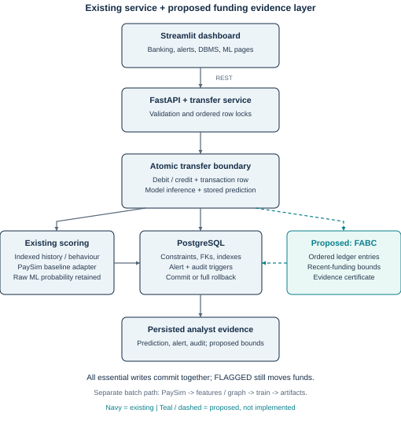
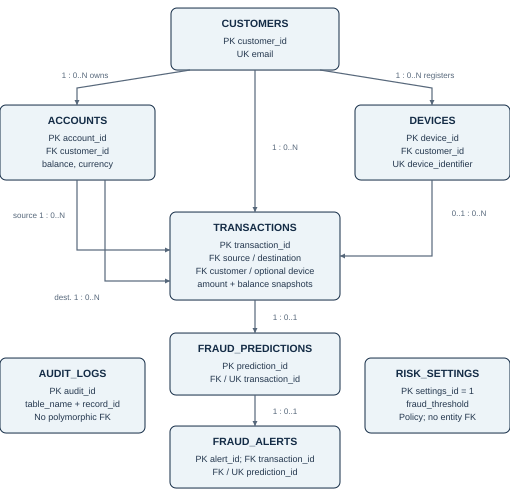
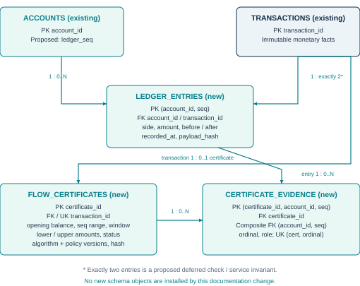

# FraudDetectAI: academic project and novelty proposal

> Status: FABC is proposed, not implemented. Generated PDF and diagrams are rebuilt with scripts/create_project_proposal.py.

## FraudDetectAI

A DBMS project with an evidence-first fraud detection extension

### Proposed novelty: Funding Ambiguity Bounds Certificate (FABC)

A transaction-consistent method that calculates how much of an outgoing payment must, and how much could, be funded by recent incoming transfers. It stores the answer with the exact ledger evidence needed to replay it.

> Academic proposal | 12 October 2026 | Existing system reviewed against repository source. FABC is a proposed extension; this report does not claim it has been implemented, benchmarked or proven patentable.

### The project in one paragraph

Customers own bank accounts and registered devices. A FastAPI service validates internal transfers, locks affected rows, changes balances, runs a fitted fraud model and saves a prediction. PostgreSQL creates alerts and redacted audit records through triggers. Streamlit displays banking operations and investigation views. A separate PaySim pipeline trains transaction-only and graph-enhanced models.

### Why this is a useful addition

Fast receipt-and-forward behaviour can indicate a pass-through account, but it also occurs in legitimate collections. Money in an account is fungible: timing alone cannot establish which receipt funded a payment. FABC expresses that uncertainty explicitly and turns the explanation into a reproducible database record.

| Pages | Contents |
| --- | --- |
| 2-3 | Existing project, finance concepts and proposed contribution |
| 4-6 | System architecture and existing / proposed database relations |
| 7-9 | Exact algorithm, examples, SQL and transaction protocol |
| 10-12 | DBMS concepts, implementation roadmap and evaluation |
| 13-14 | Prior art, patent framing, references and viva explanation |

## 01 / What the project already does

Existing implementation, without overstating its capabilities

| Layer | Responsibility and source |
| --- | --- |
| Interface | Streamlit banking, DBMS demonstration and original ML analysis pages. |
| API | FastAPI routes and validated request schemas in app/api and app/schemas.py. |
| Transfer service | app/services/transactions.py: ownership, status, balance and currency checks; ordered account locks; atomic persistence. |
| Online detection | Existing fitted PaySim baseline through app/services/inference.py; separate SQL behaviour features and heuristic risk. |
| Database | SQLAlchemy entities, Alembic migrations, PostgreSQL triggers, audit logs, views, indexes and functions. SQLite is a local fallback. |
| Offline ML | src/fraudgraph: validation, feature engineering, NetworkX graph, LR / RF / XGBoost, evaluation and explanations. |

### One transfer, one atomic outcome

The service locks the initiating customer and both accounts, writes the debit and credit snapshots, queries historical behaviour and runs inference. It stores raw model probability and final risk; prediction insertion invokes the alert trigger. Essential failures roll back the balances, transaction, prediction, alerts and audits together.

Current risk = max(model_probability, 0.9 x behaviour_score). This is an alert heuristic, not a calibrated probability. FRAUD and SUSPICIOUS are workflow labels, not established facts about criminal activity. A FLAGGED transfer still posts money; the application does not implement a payment hold.

### Limits that matter to the proposal

Only same-currency internal transfers are supported. The live API uses a baseline model, not the offline graph artifact. Full-graph aggregates and fraud-rate features can leak future information or labels. PaySim training is not validation on real bank customers. SQLite cannot demonstrate PostgreSQL row-level locks or stored functions.

## 02 / Novelty and financial reasoning

A precise, feasible contribution to investigate

### Research question

Can a database produce an exact, replayable interval for the recent-money share of a transfer, and use a high unavoidable share to prioritize review while controlling false alerts and transaction latency?

| Concept | Meaning in this project |
| --- | --- |
| Fungibility | An account balance does not label individual rupees by origin. Several allocations can explain the same ledger. |
| Recent funding | Credits recorded within a chosen window before the target debit; recent does not mean illegal. |
| Lower bound | The amount that must come from recent credits even if older funds are spent first wherever possible. |
| Upper bound | The amount that could come from recent credits under another feasible allocation. |
| Ambiguity width | Upper minus lower, divided by payment amount. A wide interval weakens attribution claims. |
| Certificate | A stored result, policy version, ledger sequence boundary and ordered evidence, committed with the transfer. |

### The candidate contribution

Combine a one-account, chronological balance-conservation algorithm with a database protocol that binds its bounds to an immutable ledger prefix. Keep ML probability separate. Expose the lower bound, upper bound and data-completeness status to an analyst rather than inventing a unique funds path.

### Why it is doable

The minimum version needs three tables, a per-account sequence counter, one indexed ordered history query and an O(n) Decimal algorithm. It uses the existing FastAPI, SQLAlchemy, Alembic, PostgreSQL and Streamlit stack; no GNN, blockchain or new distributed service is needed.

> The interval mathematics and transactional techniques may already be known. Academic distinctiveness is a hypothesis about their integration and evaluation in this system; patent novelty must survive a wider search and claim comparison. [1-4]

## 03 / System architecture

Existing components and the proposed extension are explicitly marked



FABC executes inside the existing transfer boundary after locks and before final persistence. Its history comes from the source account ledger. The proposal stores evidence alongside the ordinary prediction, while the existing alert and audit mechanism continues to operate.

## 04 / Existing database relationships

Actual entities and constraints in app/db/models.py



Arrows point from referenced parent to child; labels show parent : child cardinality. A device is optional on a transaction. Source and destination are distinct account roles. Audit logs and risk settings are intentionally outside the entity FK chain.

The schema allows at most one prediction per transaction and at most one alert per prediction. Exactly one prediction on a completed service transfer is an application invariant. Composite FKs enforce source-account ownership, device ownership and agreement between an alert and its prediction / transaction.

## 05 / Proposed schema and relationships

New tables for ordering, evidence and reproducibility



| Proposed object | Key constraints and role |
| --- | --- |
| accounts.ledger_seq | A BIGINT counter advanced under the account lock. Orders every credit / debit on that account; not a global commit sequence. |
| ledger_entries | PK (account_id, seq); FK to account and transfer; UNIQUE(transaction_id, side). side is DEBIT or CREDIT. Positive NUMERIC amount, nonnegative balances and arithmetic checks. |
| flow_certificates | Unique transaction FK, source account, opening sequence / balance, target debit sequence, window bounds, lower / upper amounts, status, evidence digest and versioned parameters. |
| certificate_evidence | FK to certificate; composite FK to ledger entry. Ordered entries with OPENING_ANCHOR, HISTORY or TARGET roles. Store every required entry, not just selected suspicious receipts. |

For a valid certificate enforce 0 <= lower <= upper <= target amount. A composite FK to a UNIQUE(transaction_id, account_id, side, seq) ledger key can bind the target to the actual source DEBIT. Cross-row conservation and two-entry completeness need deferred constraint triggers or a restricted write service; a row CHECK alone is insufficient.

## 06 / The exact bounds algorithm

One account, one fixed window, all posted movements

### Inputs and assumptions

Let x be the proposed debit. Let B be the balance at the start of the window. Treat that opening balance as old money, even if its origin is unknown. Read all account entries in sequence after the window boundary and before the target debit. All credits in this interval are recent. No overdrafts, unrecorded balance changes, fees, FX or missing movements are allowed.

L and U are the minimum and maximum recent-money balance that could remain. Start L = U = 0. Track B exactly in Decimal or integer minor units. Sequence order governs causality; the server-recorded window determines which credits qualify.

```text
For a credit c:
    B = B + c
    L = L + c
    U = U + c

For an earlier debit d (require 0 < d <= B):
    L = max(0, L - d)
    U = min(U, B - d)
    B = B - d

Before target debit x (require 0 < x <= B):
    lower_amount = max(0, x - (B - L))
    upper_amount = min(x, U)
    lower_share = lower_amount / x
    upper_share = upper_amount / x
```

### Why the bounds are exact under these assumptions

At a debit, spending recent funds first minimizes the recent balance left; spending old funds first maximizes it. Both choices are feasible because funds are fungible and balances stay nonnegative. Induction over credits and debits gives attainable endpoints L and U. For the target, at most B-L old money can be available, and at most U recent money can be available.

The scan takes O(n) arithmetic operations with O(1) working state; keeping n evidence rows costs O(n) storage. A B-tree prefix lookup adds query overhead. Individual payment intervals are marginal bounds: their upper amounts must not be summed as if jointly attainable.

> MVP scope is one account and one window. Multi-hop source attribution requires additional shared-capacity constraints and is future work, not a property of this algorithm.

## 07 / Worked examples and review policy

Concrete numbers, including an important benign counterexample

### Example A: recent money is unavoidable

| Event | Balance B | Possible recent balance [L,U] |
| --- | --- | --- |
| Window opens with INR 1,000 | 1,000 | [0, 0] |
| Credit INR 4,000 from A | 5,000 | [4,000, 4,000] |
| Credit INR 3,000 from B | 8,000 | [7,000, 7,000] |
| Credit INR 2,000 from C | 10,000 | [9,000, 9,000] |
| Earlier debit INR 2,000 | 8,000 | [7,000, 8,000] |
| Target debit INR 7,500 | Before debit: 8,000 | Target recent amount: [6,500, 7,500] |

Lower share = 6,500 / 7,500 = 86.67%; upper share = 100%. At least INR 6,500 must be recently received money under every feasible allocation. Three incoming counterparties plus a fast onward payment makes this a candidate for pass-through review.

### Example B: a funded business account remains ambiguous

Opening balance INR 100,000; recent receipts INR 9,000; target debit INR 7,500. The recent-funding interval is [0, 7,500], or [0%, 100%]. The account could pay entirely from older funds. A heuristic based only on nearby receipts might imply a linkage the ledger cannot establish.

### A transparent initial policy, not a probability

For a course demo, request review when lower_share >= 0.80 AND at least three distinct incoming counterparties appear in a ten-minute window. These are starting parameters for evaluation, not regulatory thresholds. Store the flow result separately from model_probability and behaviour_score.

A lower bound of zero does not prove innocence. A high lower bound does not prove fraud: merchant settlements, family collections and payroll accounts can show the same pattern. If evidence is incomplete, status is INCOMPLETE and bounds are NULL, not zero. A flow flag queues investigation; it does not silently block the transfer.

## 08 / SQL and transaction protocol

A concrete integration design for PostgreSQL

### Ordered evidence extraction (illustrative new schema)

```text
SELECT account_id, seq, transaction_id, side, amount,
       balance_before, balance_after, recorded_at
FROM ledger_entries
WHERE account_id = :source_account
  AND seq > :opening_seq
  AND seq < :target_debit_seq
ORDER BY seq;

-- Proposed supporting index:
CREATE INDEX idx_ledger_account_recorded_seq
ON ledger_entries(account_id, recorded_at, seq);
```

Find the first entry at or after window_start, using the same account prefix. The preceding entry is the opening anchor; its balance_after is the opening balance. If no movement occurs in the window, use the locked pre-transfer balance and the preceding sequence. Validate sequence continuity and every before / after snapshot. A missing anchor or balance gap makes the result INCOMPLETE.

### Commit protocol

1. Begin a fresh database transaction. Keep the current customer lock and globally ordered account locks. All movement writers must acquire the affected account locks before changing balances or allocating sequences.

2. Allocate one new sequence on each account. Choose server recorded_at after acquiring locks; enforce nondecreasing timestamps per account. Store exactly one DEBIT and one CREDIT for the internal transfer. Event timestamps supplied by callers are metadata, not ledger ordering keys.

3. Query the source prefix ending immediately before its new DEBIT. Compute bounds; save the certificate, opening anchor, full evidence membership and target reference. Preserve the ordinary inference result and version the flow policy.

4. Save prediction and any review flag. Trigger audits and alerts; commit every essential write together. A failure aborts all writes. A proposed bounded scan cap returns INCOMPLETE with a reason and no numerical claim; it never computes a false exact bound from truncated history.

> Current locking is adequate only if every balance movement obeys the account-lock protocol. Direct SQL writers must be restricted. A separate multi-account graph scan would require a stable snapshot / serializable protocol and retries; sequences alone do not create a global snapshot. [5]

## 09 / DBMS concepts made visible

What to explain and demonstrate in an academic assessment

| Concept | Concrete application and demonstration |
| --- | --- |
| Primary / foreign keys | Customer-account-device-transfer-prediction-alert chain; proposed composite ledger references prevent evidence from pointing to a nonexistent entry. |
| Constraints | Nonnegative balances, positive amounts, distinct accounts, ownership FKs, monetary arithmetic and score ranges. Try an invalid insert and show rejection. |
| Normalization | Separate customer, account, device, prediction and alert facts. Proposed certificates separate a derived result from a many-to-many evidence relation. |
| Denormalization | Existing transaction.customer_id and alert.transaction_id are deliberate redundant navigation keys; composite FKs preserve agreement. Do not claim strict 3NF for every table. |
| Atomicity | Inject an inference / certificate write failure and show that all balances and associated rows roll back. |
| Isolation | Run opposite-direction or simultaneous debit requests; show ordered row locks and absence of double spending. Account sequences order new ledger facts. |
| Consistency / durability | Balance checks and ledger continuity preserve valid state; committed data remains after reconnect / database restart. |
| Triggers / procedures | Existing alert and audit triggers, PostgreSQL velocity/statistics functions; proposed deferred check for exactly two ledger entries. |
| Indexes / query plans | Existing customer-time and risk indexes; proposed account-time-sequence index. Use EXPLAIN ANALYZE at meaningful volumes. |
| Views / joins | Existing suspicious-transaction and customer-risk views; proposed certificate detail view joins results and evidence. |

### Reproducibility and retention

Hash canonical ordered evidence plus the opening balance, target, window and algorithm / policy version. Use fixed decimal strings, UTC timestamp formatting and a specified field order. A digest detects mismatched replay inputs; it is not proof against a privileged administrator who can rewrite data and hashes. Append-only permissions and backups remain necessary.

Keep ledger monetary facts immutable; later alert reviews are separate workflow events. Existing demo cleanup deletes disposable rows, so the new ledger should use a dedicated demo dataset or explicit retention handling. Never silently cascade-delete evidence used by a certificate.

## 10 / A feasible implementation roadmap

Estimated 2-3 weeks for a small team; adjust to course deadlines

| Milestone | Work and acceptance evidence |
| --- | --- |
| 1. Schema and ordering<br>Days 1-3 | New Alembic migration; ledger counter; append-only entries; opening anchors; indexes. Seed reproducible account histories. Existing migrations remain untouched. |
| 2. Bounds engine<br>Days 4-6 | app/services/flow_bounds.py with Decimal math, contiguous-prefix validation and clear result statuses. Verify against exhaustive small integer allocations. |
| 3. Atomic integration<br>Days 7-10 | Extend process_transfer to write ledger and certificate in the same transaction. Add unique idempotency keys for retry-safe requests; injection and concurrency checks. |
| 4. Analyst interface<br>Days 11-13 | Display lower / upper shares, opening balance, chronological evidence and policy version. Add separate flow review flag and a certificate replay endpoint. |
| 5. Evaluation / viva<br>Days 14-18 | Compare baselines, run ablations and query-plan measurements; export results and rehearse rollback / replay demonstration. |

### Minimum viable scope

One account, one ten-minute window, internal transfers only, exact interval scan and persisted evidence. Start with a separate flow flag on the certificate. If integrating flow flags into fraud_alerts, add a new versioned trigger policy and preserve the existing one-alert-per-prediction constraint; merge reasons instead of inserting duplicate alerts.

### Extension points

New models belong in app/db/models.py through a new migration. Extend app/services/transactions.py after locks and before commit. Add a flow detail view on the Banking page. Use a separate synthetic evaluation script with saved random seeds; avoid changing the baseline model feature contract.

### Engineering tradeoff

A fixed-window scan is easier to verify than a cache whose boundary expires continuously. Measure the scan first. Set an explicit history cap and surface INCOMPLETE when exceeded. Checkpoints or incremental bounds should come later, with exact window-expiry logic and replay equivalence tests.

> This change delivers the design document and diagrams. It does not install the proposed schema or alter transfer behaviour. The effort estimate is a planning assumption, not a delivery guarantee.

## 11 / Evaluation that can support the claim

Separate correctness, detection utility and database cost

### Data and leakage controls

Generate balance-valid internal ledgers with planted pass-through patterns and matched benign patterns: merchant aggregation, salaries, family pooling, refunds, long-lived balances and split payments. Preserve seeds and withheld labels. These experiments test designed scenarios, not real-bank generalization.

PaySim can benchmark the existing transaction model, but it does not supply the full local ledger protocol, application devices or certified funding provenance. Its step is hourly, so it cannot establish ten-minute timing. Run any PaySim interval study at its actual time resolution and validate ledger completeness; otherwise mark it unsupported.

Use chronological train / validation / test splits. Select flow windows and thresholds on validation only. At inference, exclude target / future graph aggregates and unavailable fraud labels. Compare against a repaired historical graph baseline, not the existing potentially leaked full graph.

| Experiment | Evidence to report |
| --- | --- |
| Correctness | Exhaustive allocation oracle on small integer histories; lower / upper attainability; boundary times, prior debits, gaps, opening anchors and zero-history cases. |
| Detection baselines | Current ML + behaviour; velocity + fan-in heuristic; FIFO attribution policy; FABC lower-bound flag. Keep data and review budgets identical. |
| Ablations | Upper-bound-only vs lower-bound flag; remove counterparty condition; vary opening balance and window; same engine with / without persisted certificate for system cost. |
| Detection metrics | Precision, recall, average precision where a ranking exists, false alerts per 1,000 benign transfers, recall at a fixed review budget and alerted amount. |
| Database metrics | p50 / p95 / p99 transfer latency; scanned rows; certificate bytes; lock wait time; throughput; rollback failures; exact replay agreement. |
| Concurrency / recovery | Simultaneous credits/debits, failed inference, certificate failure, retry/idempotency, reversal as a new movement and restart persistence. |

> No improvement figures are asserted. A successful research outcome may be a more faithful explanation at similar detection quality; measure the cost of that explanation as well as its benefit.

## 12 / Prior art and patent framing

A bounded preliminary search, not a patentability opinion

| Reference | Known contribution / relevance |
| --- | --- |
| [1] FlowScope, AAAI 2020 | Detects money-laundering flows using multipartite transaction graphs. Flow-based detection itself is established prior art. |
| [2] US11854091B1 | Transaction tracing includes FIFO attribution and graph transformation. Generic funds tracing or putting it in a database is not a defensible new claim by itself. |
| [3-4] IP India | Novelty, inventive step and exclusions matter. Section 3(k) excludes mathematical / business methods, computer programmes per se and algorithms; CRI Guidelines 2025 inform examination. |
| [5] PostgreSQL isolation | Row locks, snapshots, serialization handling and transactional persistence are established database mechanisms. |

### A narrower invention hypothesis to investigate

A database processing method that generates attainable recent-funding bounds from an ordered account ledger, binds each decision to a validated evidence prefix and atomically persists the bounds certificate with the financial movement. The proposed technical objective is consistent, replayable evidence under concurrent writes with bounded query cost.

The question is whether this particular combination is new and non-obvious compared with attribution intervals, taint analysis, provenance certificates and transaction-consistent incremental analytics. The formula, hash, lock or dashboard alone should not be presented as an invention. A faster query, better consistency or reduced evidence storage must be implemented and measured before asserting a technical advantage.

### What remains before any filing decision

Search patent families and papers for funding-source bounds, fungible-flow attribution, lower / upper taint bounds, flow-conservation intervals, provenance snapshots and ledger certificates. Compare independent claims and priority dates; check Indian and international equivalents. Document the actual implementation and experimental technical effects, then review eligibility and disclosure timing with the institution IP cell or a patent professional.

> Recommended academic positioning: an uncertainty-aware, transaction-consistent evidence extension for a banking DBMS. Potentially worth an invention disclosure after validation; patent eligibility, novelty, freedom to operate and grant prospects remain unresolved.

## 13 / References and viva explanation

Primary sources checked on 12 October 2026

[1] Li et al. FlowScope: Spotting Money Laundering Based on Graphs. AAAI 2020, 34(4), 4731-4738. DOI: 10.1609/aaai.v34i04.5906. <link href="https://ojs.aaai.org/index.php/AAAI/article/view/5906" color="#087F8C">Publisher record</link>.

[2] Systems and methods for transaction tracing. US11854091B1, published 26 December 2023. <link href="https://patents.google.com/patent/US11854091B1/en" color="#087F8C">Patent text and claims</link>. Cited for technical disclosure, not an independently verified legal-status assessment.

[3] Intellectual Property India. Patents Act, Section 3(k), and Basics of Patents. <link href="https://www.ipindia.gov.in/acts/patent-act-1970/section-3" color="#087F8C">Section 3</link>; <link href="https://ipindia.gov.in/basics-of-patents" color="#087F8C">Patent basics</link>.

[4] CGPDTM. Guidelines for Examination of Computer Related Inventions (CRIs), 2025. <link href="https://ipindia.gov.in/resource/patents-resources-guidelines" color="#087F8C">Official guidelines catalog</link>. Release announcement: <link href="https://www.pib.gov.in/PressReleasePage.aspx?PRID=2149719" color="#087F8C">Press Information Bureau</link>.

[5] PostgreSQL documentation. Transaction Isolation. <link href="https://www.postgresql.org/docs/current/transaction-iso.html" color="#087F8C">Official documentation</link>. Stronger isolation can require retries; an account sequence is not a global transaction snapshot.

### Repository evidence reviewed

README.md; docs/ARCHITECTURE.md; docs/DATABASE_DESIGN.md; app/db/models.py; app/services/transactions.py; app/services/features.py; src/fraudgraph/models/train_graph_enhanced.py. These establish the current system and its limitations. No existing model metrics are reproduced as evidence of the new proposal.

### A 60-second project explanation

"Our project is a relational banking system with AI-assisted fraud review. Transfers, predictions, alerts and audit history commit together, and constraints protect account ownership and balances. Our proposed addition asks how much of a payment must come from recent receipts. Because money is mixed, we compute an interval rather than assert a single source. We save that interval with the exact ordered ledger evidence so a reviewer can reproduce it. We will test correctness, benign counterexamples, review quality and database overhead. This is a research proposal; we do not claim a patent or proven detection improvement."

### The strongest demonstration

Run the two numerical examples; show a saved bounds certificate and replay; then inject a write failure and demonstrate complete rollback. Finally run concurrent transfers and verify that every certificate refers to a valid source-account prefix. Label these as future acceptance demonstrations until the extension is built.
